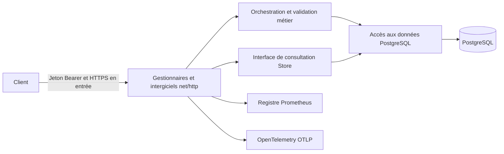

# Architecture et règles métier

StreamOps administre un catalogue de services de streaming. Un processus Go unique traite les requêtes REST ; PostgreSQL constitue la source de données de référence. Le périmètre fonctionnel porte sur le backend, sans interface graphique ni moteur de diffusion vidéo.

`cmd/api` assemble les dépendances, traite les signaux et gère la durée de vie des ressources. `internal/config` valide les variables d’environnement. `internal/http` gère les représentations REST, le décodage strict, la pagination, les autorisations et CORS. `internal/domain` contient les entités et les transitions d’état. `internal/service` définit les cas d’usage et le contrat de persistance. `internal/repository` exécute les requêtes paramétrées et les transactions atomiques de lecture, modification et écriture. `internal/observability` gère les journaux, les métriques et les traces. Le paquet `migrations` embarque les fichiers SQL dans le binaire.

Les clés des services sont uniques dans toute l’application, immuables et composées de caractères ASCII minuscules, même entre environnements. Les états possibles sont `operational`, `degraded`, `outage` et `maintenance`. Les modifications verrouillent la ligne du service ; des changements simultanés portant sur des champs différents préservent les valeurs respectives. Aucune route de suppression n’est exposée afin de conserver les relations entre services, incidents et historique.

Un incident commence à l’état `open`. Les dates de confirmation et de résolution sont enregistrées à partir de l’horloge PostgreSQL. La transition directe `open` vers `resolved` est autorisée. La résolution exige un résumé et rend l’incident immuable. Une modification verrouille la ligne et ajoute l’événement dans la même transaction. Les changements de métadonnées et les modifications sans changement d’état ajoutent aussi un événement. L’historique conserve les états et les résumés de résolution, sans instantané complet des champs ni identité individuelle. Les jetons partagés n’établissent donc pas un audit nominatif. Les contrôles de santé ne modifient pas automatiquement l’état d’un service et ne créent pas d’incident.

Les contrôles de santé enregistrent les mesures envoyées par les clients avec un horodatage serveur. Ils ne récupèrent pas d’URL et ne planifient pas de sondes, ce qui évite une surface d’attaque SSRF liée à cette fonction. Les détails ne doivent contenir aucun secret. La conservation relève de la politique d’exploitation ; prévoyez un archivage ou un partitionnement lorsque le volume le justifie.

Les listes sont triées par date de création, d’ouverture ou de contrôle décroissante, puis par UUID pour départager les égalités. Le total et les éléments proviennent du même instantané `repeatable-read` en lecture seule. La taille par défaut est de 20, le maximum de 100 et le décalage maximal de 1 000 000. L’arrivée de nouvelles lignes peut décaler les pages entre deux requêtes. Une pagination par curseur pourra être introduite si les mesures le justifient. Des exemples de plans figurent dans `docs/performance.md`.

Les migrations sont des fichiers SQL embarqués et ordonnés. Un verrou consultatif transactionnel sérialise leur application ; les sommes de contrôle détectent les modifications des fichiers déjà appliqués. Toutes les migrations en attente sont appliquées atomiquement. Ajoutez un nouveau fichier numéroté pour chaque évolution. Aucun retour arrière destructif automatique n’est prévu : utilisez une correction supplémentaire ou une restauration vérifiée. L’API contrôle les migrations avant d’accepter les requêtes. Une indisponibilité de la base au démarrage arrête le processus ; Compose attend son état de santé et l’orchestrateur peut relancer l’application. Les écritures non idempotentes ne sont jamais répétées automatiquement.

Les journaux contiennent les modèles de route, les identifiants, les codes de réponse et la durée, sans paramètres d’URL, corps de requête, jetons ni détails d’erreurs SQL. Les dimensions Prometheus sont bornées par les routes, les méthodes et les réponses. Les traces OTLP facultatives utilisent le contexte W3C, un export par lots et un échantillonnage de 10 % respectant le parent. Un contexte parent entrant peut influencer l’échantillonnage ; appliquez des limites au collecteur en exposition publique. Le traçage couvre les requêtes HTTP, et non chaque instruction SQL. Sans destination OTLP, le fournisseur de traces reste inactif.
